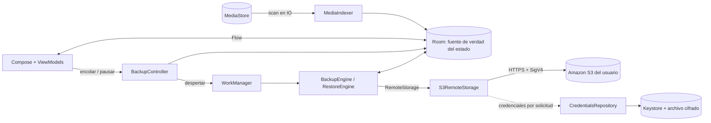

# Arquitectura

Un único módulo Gradle (`:app`) con paquetes por responsabilidad. Suficiente para el alcance actual; separar en módulos no aportaría nada todavía.

```
com.s3vault.app
├── domain/          modelos, máquina de estados, claves S3, validación, errores, contratos (RemoteStorage, AwsCredentialsProvider)
├── data/local/      Room (índice y estado de sincronización), MediaStore (lectura), MediaIndexer (reconciliación)
├── data/remote/     S3RemoteStorage (AWS SDK for Kotlin) + clasificación de errores
├── auth/            CredentialsRepository (validación, caducidad, almacenamiento), parser de credenciales temporales
├── security/        SecretStore (Android Keystore + AES-GCM), Redactor/SafeLog
├── settings/        AppSettings (DataStore, sin secretos)
├── sync/            BackupEngine, RestoreEngine, RemoteCatalog, controladores, WorkManager
└── presentation/    Compose: pantallas, ViewModels, navegación, tema
```

## Flujo de datos



Principios:

- **Room es la fuente de verdad** del estado local de sincronización. La cola de transferencias es el conjunto de filas `QUEUED`; no existe cola en memoria. Matar el proceso no pierde trabajo: al arrancar el motor, `UPLOADING/VERIFYING` vuelven a `QUEUED`.
- **S3 es solo almacenamiento de archivos.** No hay manifiesto remoto: el catálogo se deriva de `ListObjectsV2` porque la clave ya contiene `assetId`, `versionId` y nombre.
- **La UI nunca habla con S3 ni con credenciales**: usa `RemoteStorage`/`AwsCredentialsProvider` a través de controladores. La lógica de galería no sabe si la credencial es temporal o estática.
- **Hilos:** MediaStore, hashing y disco en `Dispatchers.IO`; todo el trabajo S3 se fija a IO dentro de `S3RemoteStorage` (incluido el cierre del cliente), porque los ViewModels llaman desde `Main`. Hubo un bug real de `NetworkOnMainThreadException` en la build release que lo demostró; hay una prueba instrumentada que lo protege.
- **Sin DI framework:** `AppContainer` es un grafo manual. Menos dependencias, arranque más simple.

## Dependencias (verificadas)

| Dependencia | Versión | Por qué |
|---|---|---|
| AWS SDK for Kotlin `aws.sdk.kotlin:s3` | 1.9.23 | Soporte **oficial** de Android (API 24+; `minSdk` del proyecto es 29), firma SigV4, soporte de checksums SHA-256, mantenido por AWS. No hay firma AWS manual en el código. Verificado: compila, corre en ART (API 37) y en la build minificada con R8 (APK release ≈ 4,9 MB). |
| Kotlin / AGP / Gradle | 2.3.21 / 8.13.2 / 8.13 | Estables y compatibles entre sí. |
| Compose BOM / Material 3 | 2026.04.01 | La BOM más reciente (2026.09) exige `compileSdk 37` y AGP 9.1+. Se fijó una versión que compila con la plataforma 36 instalada. |
| Room / WorkManager / DataStore | 2.8.5 / 2.11.2 / 1.2.1 | Índice local, trabajo persistente con restricciones, preferencias no secretas. |
| Coil 3 (+ coil-video) | 3.4.0 | Miniaturas bajo demanda decodificadas al tamaño de la celda; fotogramas de vídeo. |
| OkHttp (transitiva del SDK) | forzado a 5.3.2 | 5.4+ exige `compileSdk 37`. El SDK funciona con 5.3.x. |
| Tests | JUnit 4, MockK, MockWebServer 5.3.2, Robolectric 4.16.1, Espresso 3.7.0 | Espresso 3.7.0 es necesario en Android 17 (el anterior usa una API oculta eliminada). |

Descartado tras evaluar: Amazon Cognito, SDK Java v2 (más pesado), firma SigV4 manual, bibliotecas S3-compatibles de terceros, Hilt, Paging, `androidx.security:crypto` (obsoleta; se usa Keystore + AES-GCM directamente de la plataforma).

## Decisiones relevantes

- **`minSdk 29`:** MediaStore con *scoped storage* sin permisos de escritura heredados; las restauraciones se publican en `Pictures/S3Vault` con `IS_PENDING`.
- **Sin multipart:** `PutObject` con SHA-256 explícito es simple y verificable. Límite de 4 GiB por archivo (el máximo de S3 es 5 GiB). Consecuencia: no hay cargas multipart incompletas que facturar.
- **MediaStore IDs:** imágenes y vídeos viven en tablas distintas con IDs que pueden solaparse; los vídeos se desplazan `1 shl 40` para tener una clave primaria única.
- **Galería completa en memoria:** la cuadrícula observa la lista entera desde Room (sin Paging). Aceptable para decenas de miles de filas pequeñas; revisar si se llega a cientos de miles (ver [testing.md](testing.md#validación-manual-pendiente)).
- **Cliente S3 perezoso y por configuración:** se crea en el primer uso (en IO) y se reemplaza al cambiar bucket/región. Las credenciales se resuelven **en cada solicitud** mediante un adaptador, de modo que la caducidad se aplica inmediatamente.
- **Debug vs release:** el `network_security_config` de `main` solo permite HTTPS. Únicamente `src/debug` permite HTTP a `localhost` para las pruebas con servidor simulado.
