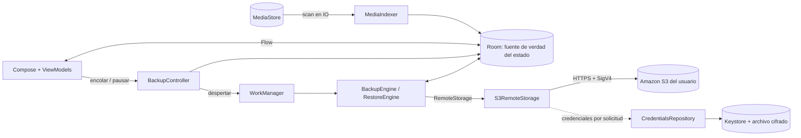

# Arquitectura

Un único módulo Gradle (`:app`) con paquetes por responsabilidad. Suficiente para el alcance actual; separar en módulos no aportaría nada todavía.

```
com.s3vault.app
├── domain/          modelos, máquina de estados, claves S3, validación, errores, contratos (RemoteStorage, AwsCredentialsProvider)
│   ├── library/     fechas (origen y claves de día), analizador de búsqueda, filtros y consulta de la galería: código puro
│   ├── cost/        inventario del bucket, tabla de precios (generada) y estimador de coste: código puro
│   ├── sync/ integrity/ space/ duplicates/ smart/   centro de sincronización, veredictos de la auditoría, reglas de espacio, hash perceptual y agrupación, filtros de álbumes inteligentes: código puro
│   ├── semantic/    paquete de modelo, tokenizador BPE, codec de vectores, top-K, traductor de consultas: código puro
│   ├── onboarding/  política de cuándo se muestra el tutorial y lista de pasos de configuración de S3: código puro
│   └── privacy/     VaultCrypto (AES-GCM por fragmentos), PrivateSession, VaultKeyring, modelos: código puro
├── data/local/      Room (índice y estado de sincronización), MediaStore (lectura), MediaIndexer (reconciliación), LibrarySql (consultas de la galería)
├── data/privacy/    KeystoreKeyring (Keystore + BiometricPrompt), PrivateVaultStore (archivos cifrados + filas), PrivateMover, caché de imágenes descifradas
├── data/remote/     S3RemoteStorage (AWS SDK for Kotlin) + clasificación de errores
├── auth/            CredentialsRepository (validación, caducidad, almacenamiento), parser de credenciales temporales
├── security/        SecretStore (Android Keystore + AES-GCM), Redactor/SafeLog
├── settings/        AppSettings (DataStore, sin secretos)
├── sync/            BackupEngine (+ miniaturas), RestoreEngine, RemoteCatalog, RemotePreviewRepository, Deletion (S3 y local), controladores, WorkManager
└── presentation/    Compose: pantallas, ViewModels, navegación, tema
    ├── sync/ integrity/ space/ duplicates/ smart/ semantic/ privacy/ tools/   las herramientas de la biblioteca ([library-tools.md](library-tools.md))
    └── library/     motor y componentes compartidos por las dos galerías (ventana paginada, secciones, barra de filtros, hojas)
```

## Flujo de datos



Principios:

- **Room es la fuente de verdad** del estado local de sincronización. La cola de transferencias es el conjunto de filas `QUEUED`; no existe cola en memoria. Matar el proceso no pierde trabajo: al arrancar el motor, `UPLOADING/VERIFYING` vuelven a `QUEUED`.
- **S3 es solo almacenamiento de archivos.** No hay manifiesto remoto: el catálogo se deriva de `ListObjectsV2` porque la clave ya contiene `assetId`, `versionId` y nombre.
- **La UI nunca habla con S3 ni con credenciales**: usa `RemoteStorage`/`AwsCredentialsProvider` a través de controladores. La lógica de galería no sabe si la credencial es temporal o estática.
- **Hilos:** MediaStore, hashing y disco en `Dispatchers.IO`; todo el trabajo S3 se fija a IO dentro de `S3RemoteStorage` (incluido el cierre del cliente), porque los ViewModels llaman desde `Main`. Hubo un bug real de `NetworkOnMainThreadException` en la build release que lo demostró; hay una prueba instrumentada que lo protege.
- **Previsualizar y borrar sin backend:** las miniaturas se generan en el teléfono y se suben con el mismo cliente S3 (ningún servicio nuevo); el borrado en S3 es `DeleteObjects` con permisos IAM opcionales y acotados. Análisis de alternativas (incluidas Lambda/Object Lambda, descartadas) en [cloud-previews.md](cloud-previews.md).
- **Dos borrados, dos controladores:** `CloudDeletionController` solo habla con S3 y `LocalDeletionController` solo asienta lo que Android ya borró. Ninguno invoca al otro; la UI (`DeleteViewModel`) los ofrece como opciones separadas.
- **Estimación de costes sin peticiones nuevas:** el listado `ListObjectsV2` que ya hacen el respaldo y la pestaña S3 alimenta también un inventario (por clase de almacenamiento) que `RemoteCatalog` guarda en DataStore; la pantalla solo lo lee y lo valora con `CostEstimator`. Los precios son una tabla local generada con `tools/update_s3_prices.py` desde la API oficial de listas de precios de AWS. Detalle en [cost-estimate.md](cost-estimate.md).
- **Una galería, dos fuentes:** la galería local (MediaStore → Room) y la de S3 (listado → Room) usan el mismo modelo de consulta (`LibraryQuery`), el mismo motor (`LibraryBrowser`, `PagedWindow`, `LibraryLayout`) y los mismos componentes. Solo difieren los constructores de SQL (`LocalLibrarySql`, `CloudLibrarySql`) y lo que cada una puede afirmar: la de S3 busca y filtra **solo la lista descargada** y lo dice. Detalle en [smart-gallery.md](smart-gallery.md).
- **Listado en streaming:** `RemoteCatalog` vuelca cada página de `ListObjectsV2` (1000 claves) a Room según llega y solo purga lo que falta tras un listado que llegó al final; el inventario de costes se agrega página a página y se guarda únicamente de un listado completo.
- **Herramientas con trabajo persistido:** cada tarea larga (auditoría, duplicados, indexado semántico, descarga del modelo) escribe su resumen en `background_jobs` (`JobRecorder`) y se parte en tandas de WorkManager con trabajo único; el centro de sincronización solo lee esas filas y los recuentos del índice. Una ejecución que murió con el proceso se marca como interrumpida al arrancar.
- **Tres reglas de datos que ninguna herramienta rompe:** (1) borrar en el dispositivo y borrar en S3 siguen siendo dos acciones separadas, y las herramientas nuevas solo piden la primera por el flujo que ya existía; (2) nada se afirma sin comprobarlo (un fallo es «desconocido», no «falta»); (3) los álbumes privados **no están en el índice de la galería** (tablas propias), así que ninguna consulta existente puede filtrarlos por descuido.
- **Álbumes privados sin servidor:** clave en el Keystore atada a la identidad del usuario, archivos cifrados por fragmentos con AES-GCM y metadatos cifrados; la sesión (clave en memoria) vive en `PrivateSession` y bloquea pantallas y cachés al instante. Detalle, pérdida de clave y límites en [private-albums.md](private-albums.md).
- **Búsqueda por contenido en el dispositivo:** CLIP cuantizado con ONNX Runtime, modelo descargado una vez, opcional y verificado por SHA-256, vectores cuantizados en Room, sin ningún servicio externo de IA ([semantic-search.md](semantic-search.md)).
- **Tutorial y ayuda sin estado propio:** el tutorial de primera ejecución (`presentation/onboarding`) solo guarda *en qué punto va* (`NOT_STARTED`, `IN_PROGRESS`, `DONE`, en los ajustes) y lee de lo ya guardado si S3 está configurado, hay credenciales o se probó la conexión; no pide ni guarda secretos (los introduce el usuario en las pantallas de Ajustes, que bloquean las capturas). Una instalación que ya tenía configuración o biblioteca indexada no lo ve. Se puede repetir desde Ajustes → Ayuda y tutorial.
- **Sin DI framework:** `AppContainer` es un grafo manual. Menos dependencias, arranque más simple.

## Dependencias (verificadas)

| Dependencia | Versión | Por qué |
|---|---|---|
| AWS SDK for Kotlin `aws.sdk.kotlin:s3` | 1.9.23 | Soporte **oficial** de Android (API 24+; `minSdk` del proyecto es 29), firma SigV4, soporte de checksums SHA-256, mantenido por AWS. No hay firma AWS manual en el código. Verificado: compila, corre en ART (API 37) y en la build minificada con R8 (APK release ≈ 4,9 MB). |
| Kotlin / AGP / Gradle | 2.3.21 / 8.13.2 / 8.13 | Estables y compatibles entre sí. |
| Compose BOM / Material 3 | 2026.04.01 | La BOM más reciente (2026.09) exige `compileSdk 37` y AGP 9.1+. Se fijó una versión que compila con la plataforma 36 instalada. |
| Room / WorkManager / DataStore | 2.8.5 / 2.11.2 / 1.2.1 | Índice local, trabajo persistente con restricciones, preferencias no secretas. |
| Coil 3 (+ coil-video) | 3.4.0 | Miniaturas bajo demanda decodificadas al tamaño de la celda; fotogramas de vídeo; también muestra las miniaturas de S3 ya cacheadas en disco. |
| OkHttp (transitiva del SDK) | forzado a 5.3.2 | 5.4+ exige `compileSdk 37`. El SDK funciona con 5.3.x. |
| Tests | JUnit 4, MockK, MockWebServer 5.3.2, Robolectric 4.16.1, Espresso 3.7.0 | Espresso 3.7.0 es necesario en Android 17 (el anterior usa una API oculta eliminada). |

| ONNX Runtime Android | 1.28.0 | Solo para la búsqueda por contenido opcional (MIT). Añade peso al APK: ver [semantic-search.md](semantic-search.md#peso-del-apk). Sin otras dependencias nuevas: el `BiometricPrompt` es el del framework, EXIF y miniaturas usan la plataforma Android. |

Descartado tras evaluar: Amazon Cognito, SDK Java v2 (más pesado), firma SigV4 manual, bibliotecas S3-compatibles de terceros, Hilt, Paging 3, `androidx.security:crypto` (obsoleta; se usa Keystore + AES-GCM directamente de la plataforma).

## Decisiones relevantes

- **Room v11:** v4→v5 resúmenes de tareas; v5→v6 marcador de versión (ETag) y auditoría; v6→v7 favorita y fecha de alta; v7→v8 duplicados; v8→v9 álbumes inteligentes; v9→v10 vectores; v10→v11 álbumes privados. Todas las migraciones son aditivas (tablas o columnas con valor por defecto), están en `AppDatabase.ALL_MIGRATIONS`, y `MigrationTest` las ejecuta desde los esquemas exportados (1→…→11).
- **Room v3 (histórico):** `thumbnailUploaded` y `backupExcluded` (migración 1→2) y, para la galería inteligente, `dayKey`, `dateSource` y los índices por fecha (migración 2→3, con relleno en Kotlin); ambas probadas con el esquema exportado.
- **`minSdk 29`:** MediaStore con *scoped storage* sin permisos de escritura heredados; las restauraciones se publican en `Pictures/S3Vault` con `IS_PENDING`.
- **Sin multipart:** `PutObject` con SHA-256 explícito es simple y verificable. Límite de 4 GiB por archivo (el máximo de S3 es 5 GiB). Consecuencia: no hay cargas multipart incompletas que facturar.
- **MediaStore IDs:** imágenes y vídeos viven en tablas distintas con IDs que pueden solaparse; los vídeos se desplazan `1 shl 40` para tener una clave primaria única.
- **Sin catálogo completo en memoria:** la cuadrícula pide a Room una fila por día (para encabezados, recuentos y saltos) y las fotos por páginas de 96 con una ventana LRU de 20 páginas. No se usa Paging 3: el salto a una fecha y los recuentos por sección necesitan esa aritmética sobre los días. Medido con 20 000 elementos por galería.
- **Cliente S3 perezoso y por configuración:** se crea en el primer uso (en IO) y se reemplaza al cambiar bucket/región. Las credenciales se resuelven **en cada solicitud** mediante un adaptador, de modo que la caducidad se aplica inmediatamente.
- **Debug vs release:** el `network_security_config` de `main` solo permite HTTPS. Únicamente `src/debug` permite HTTP a `localhost` para las pruebas con servidor simulado.
