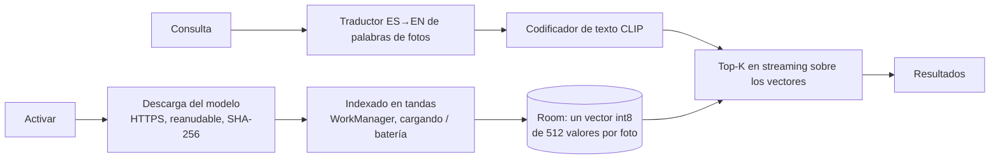

# Búsqueda por contenido en el dispositivo

Encuentra fotos por lo que se ve («playa al atardecer», «recibos», «mi perro») **sin enviar nada fuera del teléfono**: ni fotos, ni vectores, ni consultas. Es **opcional y está desactivada**: hasta que el usuario la activa no se descarga nada ni se programa ningún trabajo. Sin ella, la búsqueda por nombre, carpeta, fecha y tipo sigue funcionando igual (y también se muestra junto a los resultados por contenido).

## Cómo funciona

1. **Modelo**: CLIP ViT-B/32 cuantizado a int8 (formato ONNX), que proyecta imágenes y texto al mismo espacio de 512 dimensiones. Se ejecuta con ONNX Runtime en el CPU.
2. **Indexado**: una foto por vez (se decodifica reducida, se recorta al centro a 224×224 y se normaliza como CLIP), un vector por foto, guardado cuantizado a int8 con su factor de escala. Cada vector es válido para **un modelo y para el archivo tal como estaba** (tamaño y fecha de modificación): una foto sin cambios se procesa una vez en su vida; una que no se pudo decodificar se anota y no se reintenta hasta que cambie.
3. **Búsqueda**: se codifica el texto y se recorre la tabla de vectores **en streaming** (nunca todos en memoria), manteniendo solo los K mejores. Los resultados por contenido se muestran junto a los de nombre; si hay fotos sin indexar aún, la pantalla lo dice («N de M fotos se pueden buscar»).

Trabajo acotado y cancelable: el indexado va en tandas (por defecto solo **cargando**, con opción «Indexar ahora»), se registra en `background_jobs` y se puede pausar; la descarga es reanudable con `Range`, valida el tamaño y el SHA-256 de cada archivo y se borra lo que no coincide.

## Privacidad y datos

- El modelo vive en `filesDir/models` (almacenamiento privado de la app, ilegible para otras apps) y los vectores en Room. **No salen del dispositivo**, no hay backend, ni servicio de IA externo, ni telemetría.
- Únicas conexiones de red de esta función: la **descarga del modelo** desde `huggingface.co` (HTTPS, sin tus credenciales de AWS; el servidor ve tu dirección IP) y nada más.
- Los vectores describen el contenido de tus fotos: se pueden **borrar desde la pantalla** («Borrar los vectores»), o borrar modelo + vectores («Eliminar el modelo y los vectores…»); desactivarla detiene el trabajo y no borra nada hasta que se pida. Las fotos de los **álbumes privados** nunca se indexan (no están en la biblioteca).
- Antes de activar, la pantalla dice qué descarga (≈ 148 MiB, solo Wi-Fi por defecto), cuánto ocupa el índice y qué pasa con los datos.

## Evaluación del modelo

| | |
|---|---|
| Modelo | OpenAI CLIP ViT-B/32 (pesos en ONNX cuantizado int8 de `Xenova/clip-vit-base-patch32`, revisión fijada en la app) |
| Licencia | MIT (OpenAI CLIP) |
| Tamaño de la descarga | 155,0 MB (147,8 MiB): visión 89,1 MB, texto 64,5 MB, vocabulario 0,9 MB y fusiones 0,5 MB; ocupa lo mismo en disco |
| Memoria con ambos modelos cargados | +151 MB (nativa + montón de Java), medido en el emulador; el modelo se carga al buscar o indexar y se libera al salir de la pantalla |
| Arranque en frío | texto 405 ms, visión 952 ms (emulador x86_64) |
| Indexado | 43 ms por foto (mediana, sin contar la carga); 49–62 ms por foto incluyendo todo el flujo real (lectura, decodificación, inferencia, escritura) en el emulador |
| Consulta | 23 ms por frase (mediana) + el recorrido de vectores; 25–30 ms de punta a punta con 8 fotos con el modelo ya cargado |
| Calidad frente a la referencia en float (Python/HF) | coseno por imagen entre 0,958 y 0,989 (8 imágenes) tras cuantizar; el tokenizador BPE coincide con el de HuggingFace en el conjunto de referencia |
| Prueba de relevancia | 8 de 8 consultas devuelven primero la imagen esperada entre 8 (conjunto pequeño; **no es un benchmark**) |

**Por qué este modelo.** Permisivo (MIT), publicado como archivos ONNX con hashes estables (el pack se puede verificar byte a byte), calidad ampliamente documentada y tamaño asumible en móvil. Alternativas consideradas pero **no medidas en este proyecto**: variantes de OpenCLIP/SigLIP (licencia Apache-2.0, mejores en algunos idiomas, bastante más pesadas) y modelos móviles tipo MobileCLIP (más ligeros, pero con licencias de pesos más restrictivas o conversión ONNX no verificada para este uso). Si aparece un modelo mejor, el diseño ya lo admite: `ModelPack` define archivos, tamaños, hashes y dimensión, y los vectores se guardan **por modelo** (cambiar de modelo no mezcla vectores).

**Si no hubiera un modelo adecuado**, la función enviaría solo la arquitectura (descarga verificada, índice, búsqueda por streaming) sin ningún resultado «de relleno». Aquí sí hay uno, con las limitaciones de abajo.

## Peso del APK

ONNX Runtime añade una biblioteca nativa por ABI al APK (guardada sin comprimir):

| ABI | `libonnxruntime.so` |
|---|---|
| arm64-v8a | 27,3 MiB |
| armeabi-v7a | 19,4 MiB |
| x86 / x86_64 | ≈ 33 MiB cada una |

Medido con `assembleRelease` (R8): **APK universal con las cuatro ABI 119 MiB; solo ARM (arm64 + armv7) 53,1 MiB; solo arm64 33,6 MiB**, frente a unos 5,7 MB antes de añadir la función. La build de release se limita por defecto a **arm64-v8a** (`ndk.abiFilters`, 33,6 MiB); `-PreleaseAbis=arm64-v8a,armeabi-v7a` añade 32 bits (53,1 MiB) y `...,x86_64` permite probarla en el emulador x86. Con un *app bundle* cada dispositivo recibe solo su ABI (≈ 33 MiB en arm64). Es el coste de una búsqueda por contenido sin servidor y lo asumen **todos** los usuarios aunque no la activen; reducirlo exigiría una compilación de ONNX Runtime con solo los operadores de CLIP (no hecha) o entregar la función como módulo opcional.

## Limitaciones

- **CLIP es principalmente inglés.** Para que «playa al atardecer» funcione, la app traduce palabras de fotos muy comunes del español al inglés con un diccionario pequeño (`QueryTranslator`) y **muestra lo que realmente buscó** («Se ha buscado como: «beach at sunset»»). No es traducción automática: las palabras desconocidas pasan tal cual, y frases largas o jergas pueden dar peores resultados.
- Es **similitud**, no comprensión: puede fallar con texto dentro de la imagen, objetos pequeños, conteos o negaciones («sin gente»).
- La cuantización a int8 baja algo la fidelidad (coseno 0,96–0,99 frente a float) y se evaluó con muy pocas imágenes: no se afirma una cifra de acierto general.
- Los tiempos son de un **emulador x86_64**, no de un teléfono; en ARM real serán distintos (mejor o peor según el SoC). No se midió con decenas de miles de fotos: el diseño (vectores de 512 B + escala por foto, recorrido en streaming) escala linealmente, y 100 000 fotos serían ≈ 50 MB de vectores recorridos por consulta.
- Solo imágenes (no vídeos); HEIC/AVIF dependen del decodificador de la plataforma.
- Descargar el modelo requiere conexión a `huggingface.co`; si el servicio cambia de URL, la descarga falla con un mensaje claro y el pack se puede copiar a mano (se verifica el SHA-256 la primera vez).
