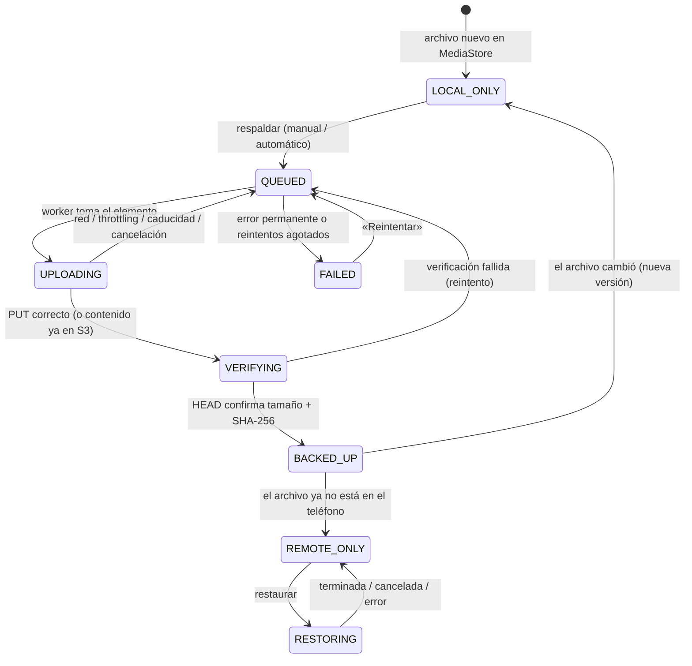

# Sincronización: respaldo y restauración

## Máquina de estados



- Implementada en `SyncStateMachine`; cada cambio pasa por `require(from, to)` y por un `UPDATE ... WHERE syncState = :from` atómico en Room, de modo que dos escritores no pueden pisarse.
- **Nunca** se pasa a `BACKED_UP` sin `VERIFYING`; no existe un booleano «subido».
- Recuperación tras cierre/reinicio: al iniciar el motor, `UPLOADING`/`VERIFYING` → `QUEUED`. `RESTORING` (en la biblioteca remota) **sí** se conserva: es la cola de restauraciones persistente y WorkManager la reanuda.
- `REMOTE_ONLY`/`RESTORING` describen también las filas de la biblioteca remota (`remote_objects`); en el índice local, `REMOTE_ONLY` significa «tuvo copia verificada y el archivo local desapareció» (`present = false`).

## Claves en S3

```
{prefijo}/photos/{assetId}/{versionId}/{nombreSanitizado}
```

- `assetId`: UUID aleatorio (32 hex) asignado una vez por archivo indexado. Dos archivos con el mismo nombre nunca colisionan.
- `versionId`: **SHA-256 del contenido** (64 hex). Contenido distinto ⇒ clave distinta ⇒ la copia anterior nunca se sobrescribe ni se pierde.
- `nombreSanitizado`: ASCII seguro (`[A-Za-z0-9._-]`), solo para poder navegar el bucket y mostrar nombres sin un `HEAD` por objeto. El nombre original exacto va en el metadato `original-name`.
- Reinstalar la app genera `assetId` nuevos, pero la deduplicación por contenido (abajo) evita volver a subir lo que ya está.

## Cuándo se calcula un hash

| Momento | ¿Hash? |
|---|---|
| Abrir la app / escanear MediaStore | **Nunca** |
| Antes de subir un elemento de la cola | Sí, en streaming (128 KiB) en `Dispatchers.IO` |
| Elemento ya con hash válido | No: se reutiliza |

El hash se guarda en Room junto con el `(tamaño, fecha de modificación)` de los bytes que lo produjeron. Solo es válido mientras ambos coincidan (`hashIsValid()`); si cambian, se invalida y se recalcula la próxima vez que haga falta. Un cambio de fecha sin cambio de contenido recalcula el hash pero **no** vuelve a subir (mismo `versionId` ⇒ se verifica con `HEAD`).

## Evitar transferencias innecesarias

1. `BACKED_UP` no se puede volver a encolar.
2. Al iniciar una tanda se hace un barrido `LIST` de `{prefijo}/photos/` (caché en Room). Si ya existe un objeto con el mismo `versionId` y tamaño (esta instalación tras un fallo, una restauración, otro dispositivo), se enlaza esa clave, se verifica con `HEAD` y se marca respaldado **sin subir**.
3. Antes de subir se comprueba si la clave exacta ya existe (`HEAD`), útil tras una subida interrumpida que sí terminó.
4. Si S3 contesta 403 (política con `ListBucket` por prefijo) al `HEAD` de un objeto inexistente, se cae a la subida normal.

## Archivos modificados

Detectado en el escaneo: `BACKED_UP` con `(tamaño, mtime)` distintos de los respaldados → `LOCAL_ONLY` (limpia error e intentos). Al respaldarlo de nuevo se hashea, sale un `versionId` nuevo y se sube **otro objeto bajo el mismo `assetId`**. La versión anterior se conserva (no hay borrado). La fila apunta a la versión más reciente. Si la nueva subida falla, la copia antigua sigue siendo válida en S3.

## Integridad

- Subida: `PutObject` con `x-amz-checksum-sha256` calculado localmente. S3 rechaza el cuerpo si no coincide (`BadDigest`).
- Verificación: `HEAD` con `ChecksumMode=ENABLED`; tamaño **y** checksum deben coincidir. En subidas nuevas el checksum es obligatorio; para objetos preexistentes sin checksum se acepta solo si el metadato `sha256-hex` coincide.
- **No se usa el ETag como MD5** (no lo es con SSE-KMS o multipart).
- Restauración: el `versionId` de la clave *es* el SHA-256 del original; el archivo descargado se verifica contra él y contra el tamaño antes de publicarse.

## Subidas con WorkManager

- `BackupWorker` (una sola cola `KEEP` + trabajo periódico para el modo automático) con restricciones: red conectada o **no medida** (solo Wi-Fi), y batería no baja para el periódico. Backoff exponencial (30 s base) en `retry()`.
- No se promete ejecución inmediata: Doze, ahorro de batería y *standby buckets* pueden aplazar los trabajos. No hay servicio en primer plano.
- Concurrencia 1–4 (ajustable) con `Semaphore`; el progreso por archivo es en memoria (cosmético); lo durable es Room.
- Excluir vídeos afecta al respaldo **automático** y a «Respaldar pendientes»; los vídeos seleccionados a mano se encolan siempre.
- Cambiar «solo Wi-Fi» reprograma el trabajo pendiente con la nueva restricción. Pausar cancela el worker, conserva la cola y devuelve cualquier elemento en vuelo a `QUEUED`.
- Tras reiniciar el dispositivo WorkManager reprograma el trabajo y `S3VaultApp` re-registra el periódico y relanza si hay cola.

## Clasificación de errores

| Tipo S3 | Clase | Reintenta | Efecto en el elemento |
|---|---|---|---|
| Red/timeout/5xx | `NETWORK` | Sí (backoff) | `QUEUED`, intentos+1 |
| `SlowDown`/503 | `THROTTLED` | Sí | igual |
| Checksum/verificación | `INTEGRITY_MISMATCH` | Sí | igual |
| Hasta 6 intentos | — | No | `FAILED` (reintentable a mano) |
| `ExpiredToken`, sin credenciales | `CREDENTIALS_*` | No | `QUEUED` **sin** consumir intentos; el run se detiene; aviso en UI |
| `InvalidAccessKeyId`/`SignatureDoesNotMatch` | `CREDENTIALS_INVALID` | No | se detiene y avisa |
| `AccessDenied` | `ACCESS_DENIED` | No | `FAILED` permanente + **bloquea la tanda** + mensaje al usuario |
| `NoSuchBucket`, región incorrecta, cuota | `BUCKET_NOT_FOUND`, `WRONG_REGION`, `QUOTA_EXCEEDED` | No | igual que permisos |
| Archivo ilegible / > 4 GiB | `FILE_UNAVAILABLE`, `FILE_TOO_LARGE` | No | `FAILED` permanente |

## Restauración

1. «Restaurar» en la biblioteca remota marca `RESTORING` (cola persistente) y lanza `RestoreWorker`.
2. `HEAD` → tamaño, ETag. Descarga a `cache/restore/<sha1(key)>.part`; si hay parcial con el mismo ETag se **reanuda** con `Range: bytes=N-` + `If-Match`.
3. Verifica SHA-256 + tamaño. Si falla, borra el parcial y reintenta desde cero.
4. Publica en MediaStore (`Pictures/S3Vault` o `Movies/S3Vault`) con `IS_PENDING`; si el nombre existe, MediaStore crea otro (`nombre (1).jpg`): **nunca se sobrescribe**. Si ya hay copia local del mismo contenido, la interfaz pide confirmación antes.
5. La foto restaurada aparece en la galería y se enlaza con el objeto por deduplicación de contenido (no se vuelve a subir).

## Catálogo remoto sin manifiesto

Se descartó un manifiesto JSON en S3: exigiría resolver escrituras concurrentes desde varios dispositivos, escrituras interrumpidas y recuperación (S3 no tiene *compare-and-swap* simple sin ETags condicionales y bloqueos). Como la clave ya lleva `assetId`/`versionId`/nombre, un `ListObjectsV2` basta. Coste: un `LIST` por 1000 objetos al refrescar; los metadatos extendidos (fecha de captura, nombre exacto) se piden con `HEAD` solo cuando abres el detalle de un objeto. Limitación: sin miniaturas remotas (exigirían descargar el original).
